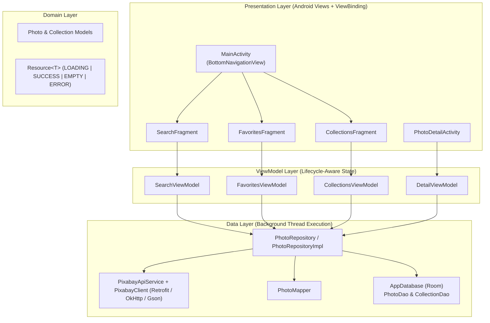

# Architecture Overview — FlickrImage Browser (Pixabay API Edition)

## 1. High-Level Design

**FlickrImage Browser** follows a pragmatic **Model–View–ViewModel (MVVM)** architecture with a dedicated **Repository layer**, written 100% in Java using Android Views, Material Design XML layouts, and `ViewBinding`. Because Flickr restricts API keys to paid Pro subscribers and Pexels API signup approval is unavailable, the remote data layer queries the **Pixabay REST API** (`https://pixabay.com/api/`) while preserving the project's `vn.edu.usth.flickrimagebrowser` namespace and domain contracts.

---

## 2. Package & Component Responsibilities

All source code resides under `vn.edu.usth.flickrimagebrowser`:

| Package | Key Classes | Responsibility |
|---|---|---|
| `(root)` | `FlickrApplication`, `MainActivity` | Application-scoped dependency initialization (`AppContainer`) and Single-Activity `BottomNavigationView` host. |
| `data/remote/` | `PixabayApiService`, `PixabayClient`, `PixabayRateLimitInterceptor` | Retrofit service definition for `GET https://pixabay.com/api/` (`key`, `q`, `editors_choice`, `order`, `image_type`, `safesearch`, `page`, `per_page`) and OkHttp client configuration (15s connect/write, 20s read timeouts, query-key redaction in debug logs). A process-wide rolling budget allows at most 100 outgoing attempts per 60 seconds, including retries. Excess requests fail locally with a wait message. HTTP 429 starts a cooldown of at least 60 seconds, extended by numeric `Retry-After` or `X-RateLimit-Reset` seconds. The budget does not coordinate other devices or survive process restarts. |
| `data/remote/dto/` | `PixabaySearchResponse`, `PixabayHitDto`, `PhotoMapper` | Gson DTOs matching Pixabay's JSON contract (`total`, `totalHits`, `hits`, `webformatURL`, `largeImageURL`, `tags`, `user`) and null-safe conversion into domain `Photo` objects. |
| `data/local/` | `AppDatabase`, `PhotoDao`, `CollectionDao` | Room SQLite persistence, reactive `LiveData` queries, and explicit schema migration definitions (`MIGRATION_1_2`). |
| `data/local/entity/` | `PhotoEntity`, `CollectionEntity`, `CollectionPhotoCrossRef`, `CollectionWithPhotos` | Database tables for saved photos, collections, and their many-to-many junction table with foreign-key cascade rules. |
| `data/repository/` | `PhotoRepository`, `PhotoRepositoryImpl` | Single source of truth coordinating Retrofit network callbacks, parameter clamping (`per_page` 3..200), HTTP/API error checks (400/401/403, 429), and background Room reads/writes via `AppExecutors`. |
| `domain/model/` | `Photo`, `Collection` | Immutable Java domain models shared across ViewModels and UI adapters. |
| `ui/` | `AppViewModelFactory` | Constructor-injected `ViewModelProvider.Factory` supplying `PhotoRepository` to ViewModels. |
| `ui/common/` | `PhotoAdapter` | Shared `ListAdapter` + `DiffUtil` rendering photo thumbnails via Glide (`webformatURL` / `previewURL`). |
| `ui/search/` | `SearchFragment`, `SearchViewModel` | Initial/cleared Featured Photos (Editor's Choice) feed, keyword search input, `Resource<List<Photo>>` pagination observation, and Loading / Empty / Error / Retry UI states. Pagination errors preserve loaded photos and pause automatic scrolling requests until explicit Retry; the Retry snackbar uses an indefinite duration while that error state is active and is dismissed on retry, manual dismissal, or a subsequent rendered state. |
| `ui/favorites/` | `FavoritesFragment`, `FavoritesViewModel` | Reactive grid of locally persisted favorite photos from Room. |
| `ui/collections/` | `CollectionsFragment`, `CollectionsViewModel`, `CollectionAdapter` | Reactive list and creation flow for user photo collections. |
| `ui/detail/` | `PhotoDetailActivity`, `DetailViewModel` | Full photo detail view loading `largeImageURL` via Glide and observing/toggling favorite state in Room. |
| `util/` | `Resource`, `AppExecutors`, `AppContainer` | Generic UI state wrapper, background thread pools (`diskIO`, `networkIO`, `mainThread`), and manual dependency container. |

---

## 3. Data Flow

### 3.1 Public Photo Search Flow
1. The user enters a keyword in `SearchFragment` and taps **Search**.
2. `SearchFragment` calls `SearchViewModel.submitQuery(query, false)`.
   - If `query` matches `lastQuery` (e.g., after a screen rotation), `SearchViewModel` does **not** re-issue the network call; `LiveData` immediately re-emits the cached `Resource<List<Photo>>`.
3. `SearchViewModel` switches on `searchTrigger` via `Transformations.switchMap`, invoking `PhotoRepositoryImpl.searchPhotos(query, page, perPage)`.
4. `PhotoRepositoryImpl`:
   - Checks that `BuildConfig.PIXABAY_API_KEY` is non-empty and not the placeholder value; otherwise immediately emits `Resource.error(...)`.
   - Clamps `perPage` to Pixabay's required `3..200` range, emits `Resource.loading(null)`, and enqueues `PixabayApiService.searchPhotos(apiKey, query, "photo", true, page, perPage)` asynchronously via Retrofit.
   - When the HTTP response arrives, validates `response.isSuccessful()` (surfacing clear error messages for HTTP `400`/`401`/`403` invalid keys/parameters and HTTP `429` rate limits).
   - Dispatches onto `AppExecutors.diskIO()` to query `PhotoDao.getFavoriteIdsSync()`, maps `PixabayHitDto` items into `Photo` domain models via `PhotoMapper`, and posts `Resource.success(list)` or `Resource.empty()`.

### 3.2 Favorites & Collections Persistence Flow
1. When the user taps the heart icon on a photo item or inside `PhotoDetailActivity`, the ViewModel calls `PhotoRepository.toggleFavorite(photo)`.
2. `PhotoRepositoryImpl` executes on `AppExecutors.diskIO()`:
   - Reads the current `PhotoEntity` from `PhotoDao.getPhotoByIdSync(id)`.
   - Upserts the `PhotoEntity` with `isFavorite = !existingFavorite` and `savedAt = System.currentTimeMillis()`.
   - If unfavorited and not referenced in `collection_photo_cross_ref`, cleans up the unreferenced row via `PhotoDao.deleteOrphanIfUnreferenced(id)`.
3. Room automatically notifies active `LiveData` observers (`FavoritesViewModel.getFavorites()` and `DetailViewModel.getIsFavorite()`), updating the UI on the main thread.

---

## 4. Key Design Decisions

1. **Java `LiveData` + `AppExecutors` instead of RxJava or Coroutines:**
   - Keeps the codebase 100% Java without Kotlin dependencies or complex reactive stream boilerplate.
   - `AppExecutors` allows unit tests (`PhotoRepositoryTest`) to inject synchronous `Runnable::run` executors so asynchronous repository logic can be tested deterministically.
2. **Pixabay Responsive Image Size Selection (Avoiding OOM & Blurry Grids):**
   - `PixabayHitDto` exposes flat image URLs (`previewURL` at 150px, `webformatURL` at 640px, and `largeImageURL` at 1280px).
   - `PhotoMapper` maps `webformatURL` (falling back to `previewURL`) to `thumbnailUrl` for crisp 2-column grid scrolling and `largeImageURL` (1280px) to `detailUrl`, avoiding multi-megabyte full-resolution bitmaps that could trigger `OutOfMemoryError`.
3. **Orphan-Safe Shared `photos` Table:**
   - Both Favorites (`is_favorite = 1`) and Collections (`collection_photo_cross_ref`) reference `PhotoEntity` in the `photos` table.
   - Unfavoriting a photo updates `is_favorite = 0` and only deletes the row if no collection references it, preventing accidental foreign-key cascade deletions from user collections.
