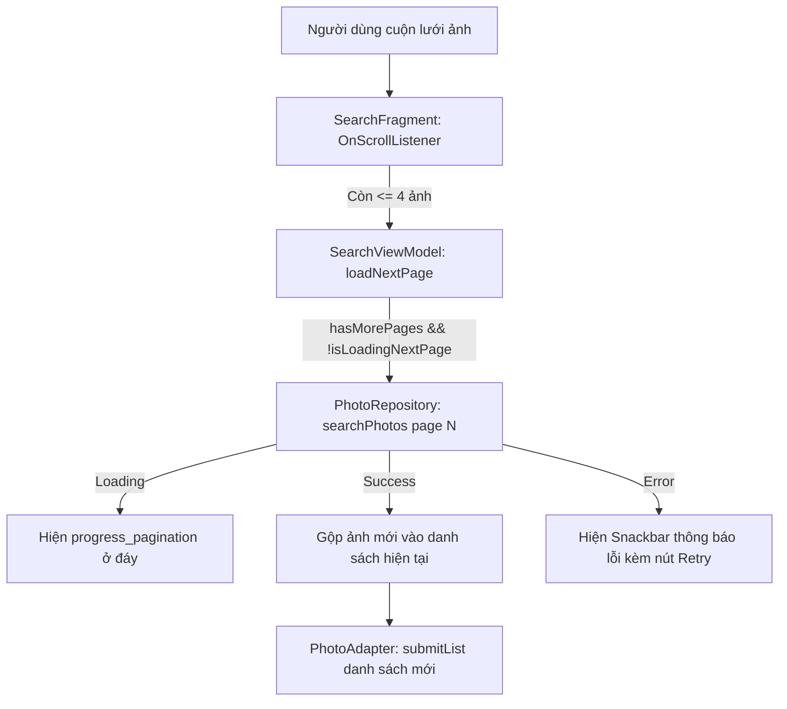

# Kế hoạch Triển khai: Member 4 (M4) — Phân trang & Cuộn vô tận cho Tìm kiếm Flickr

## Mô tả mục tiêu (Goal Description)
Hoàn thiện toàn bộ các hạng mục công việc (TODO 4.1 – TODO 4.4) được giao cho **Member 4 (Kỹ sư Giao diện Tìm kiếm, Phân trang & Lưới ảnh)** theo tài liệu [`docs/TEAM_WORKLOAD_PLAN.md`](TEAM_WORKLOAD_PLAN.md).

Mục tiêu chính:
1. **Phân trang đa trang (Multi-page Pagination):** Cho phép người dùng cuộn vô tận trong lưới ảnh tìm kiếm mà không bị mất danh sách ảnh đã tải trước đó.
2. **Quản lý trạng thái thông minh:** Tránh gọi API trùng lặp khi xoay màn hình (configuration changes), hiển thị vòng xoay tải trang tiếp theo (bottom loading) mà không làm biến mất lưới ảnh hiện tại.
3. **Phục hồi lỗi linh hoạt:** Báo lỗi qua `Snackbar` kèm nút thử lại khi tải trang tiếp theo thất bại, giữ nguyên các ảnh đã xem trước đó.
4. **Kiểm thử tự động toàn diện:** Bổ sung các bài kiểm thử đơn vị (`SearchViewModelTest`) bao phủ việc dồn kết quả qua các trang, xử lý kết quả rỗng và reset trạng thái phân trang khi nhập từ khóa mới.

---

## Những điểm cần người dùng xem xét (User Review Required)

> [!IMPORTANT]
> **Ranh giới gói (Package Boundary):**
> Member 4 chỉ thao tác trên các file thuộc phạm vi `ui/search/*`, `ui/common/PhotoAdapter.java`, `res/layout/fragment_search.xml` và `SearchViewModelTest.java`. Không chỉnh sửa trực tiếp `PhotoRepository` hay các bảng Room để tránh xung đột mã nguồn với Member 1 và Member 3.

> [!NOTE]
> **Hiển thị tiến trình tải trang tiếp theo:**
> Thay vì dùng `progressLoading` chính giữa màn hình (làm ẩn lưới ảnh cũ), chúng ta sẽ thêm một thanh tiến trình nhỏ (`progress_pagination`) ở đáy layout `fragment_search.xml`. Khi người dùng cuộn xuống đáy, danh sách ảnh vẫn giữ nguyên và thanh tiến trình đáy hiển thị để người dùng biết đang tải thêm ảnh.

---

## Câu hỏi mở (Open Questions)
- Không có câu hỏi chặn. Thiết kế tuân thủ 100% tài liệu kiến trúc MVVM + `MediatorLiveData` thuần Java của dự án.

---

## Đề xuất Thay đổi (Proposed Changes)



---

### Thành phần Giao diện & ViewModel (`ui/search`)

#### [MODIFY] `SearchViewModel.java`
- Thêm các biến trạng thái phân trang:
  - `int currentPage`: Trang hiện tại (mặc định = 1).
  - `boolean isLoadingNextPage`: Cờ đánh dấu đang tải trang tiếp theo.
  - `boolean hasMorePages`: Cờ đánh dấu Flickr còn ảnh hay đã hết.
  - `List<Photo> accumulatedPhotos`: Danh sách tích lũy các ảnh từ trang 1 đến trang hiện tại.
  - `MutableLiveData<Boolean> isLoadingMore`: LiveData báo hiệu trạng thái tải trang tiếp theo cho UI.
- Chuyển `searchResults` sang sử dụng `MediatorLiveData<Resource<List<Photo>>>`:
  - Khi `submitQuery(query, forceRefresh)`: Reset `currentPage = 1`, `hasMorePages = true`, `accumulatedPhotos.clear()`, gọi tìm kiếm trang 1.
  - Khi `loadNextPage()`: Kiểm tra điều kiện hợp lệ, tăng trang lên `currentPage + 1`, lắng nghe kết quả từ `repository.searchPhotos(lastQuery, nextPage, DEFAULT_PER_PAGE)`:
    - Nếu thành công: Nối ảnh mới vào `accumulatedPhotos`, nếu số lượng ảnh trả về < 30 thì đánh dấu `hasMorePages = false`, phát ra `Resource.success(new ArrayList<>(accumulatedPhotos))`.
    - Nếu rỗng: Đánh dấu `hasMorePages = false`, giữ nguyên ảnh đã có.
    - Nếu lỗi: Phát ra `Resource.error(message, new ArrayList<>(accumulatedPhotos))` để UI biết lỗi nhưng không xóa mất ảnh cũ.
- Bổ sung các getter hỗ trợ kiểm thử: `getCurrentPage()`, `isLoadingNextPage()`, `hasMorePages()`, `getIsLoadingMore()`.

#### [MODIFY] `fragment_search.xml`
- Thêm `ProgressBar` với id `@+id/progress_pagination` neo ở đáy màn hình (`app:layout_constraintBottom_toBottomOf="parent"`), mặc định `visibility="gone"`.

#### [MODIFY] `SearchFragment.java`
- Thêm `RecyclerView.OnScrollListener` vào `binding.recyclerPhotos`:
  - Lấy `layoutManager.findFirstVisibleItemPosition()` và `layoutManager.getChildCount()`.
  - Khi cuộn xuống và khoảng cách tới cuối danh sách `<= 4`, gọi `viewModel.loadNextPage()`.
- Cập nhật hàm `renderState(Resource<List<Photo>> resource)`:
  - Khi `LOADING`: Nếu danh sách đã có dữ liệu (đang tải trang tiếp theo), giữ nguyên hiển thị `recyclerPhotos`, không hiện `progressLoading` chính giữa.
  - Khi `ERROR`: Nếu danh sách đã có dữ liệu, giữ nguyên hiển thị `recyclerPhotos` và hiển thị `Snackbar` kèm nút "Thử lại" gọi `viewModel.loadNextPage()`.
- Lắng nghe `viewModel.getIsLoadingMore()` để bật/tắt `binding.progressPagination`.

---

### Thành phần Kiểm thử Đơn vị (`test/ui/search`)

#### [MODIFY] `SearchViewModelTest.java`
- Bổ sung các ca kiểm thử:
  1. `loadNextPage_accumulatesPhotosAcrossPages()`: Kiểm tra gọi trang 1 nhận Photo A, gọi tiếp `loadNextPage()` nhận Photo B; kết quả trả về chứa cả [Photo A, Photo B], `currentPage == 2`.
  2. `loadNextPage_doesNotTriggerWhenAlreadyLoadingOrEndReached()`: Kiểm tra khi `hasMorePages == false` hoặc đang tải thì không gọi API thêm lần nữa.
  3. `submitQuery_resetsPaginationState()`: Kiểm tra khi người dùng gõ từ khóa mới thì trang quay về 1 và danh sách cũ được dọn sạch.
  4. `loadNextPage_onFailure_preservesExistingPhotos()`: Kiểm tra khi trang 2 bị lỗi mạng, `Resource.ERROR` vẫn giữ nguyên danh sách ảnh của trang 1 trong payload data.

---

## Kế hoạch Xác minh (Verification Plan)

### Kiểm thử tự động (Automated Tests)
Chạy lệnh kiểm thử đơn vị cho toàn bộ package `ui/search`:
```powershell
./gradlew testDebugUnitTest --tests vn.edu.usth.flickrimagebrowser.ui.search.SearchViewModelTest
```
**Tiêu chí thành công:**
- Tất cả các test case (cả cũ và mới) đều đạt (`PASSED`).
- Không phát sinh ngoại lệ trên luồng chính (`InstantTaskExecutorRule` xử lý đồng bộ).

### Xác minh thủ công (Manual Verification)
1. **Tìm kiếm ban đầu:** Nhập từ khóa (ví dụ "vietnam") -> Hiển thị vòng xoay tải ở giữa -> Lưới 2 cột hiện 30 ảnh đầu tiên.
2. **Cuộn phân trang:** Cuộn xuống đáy danh sách -> Vòng xoay nhỏ ở đáy hiện lên -> 30 ảnh tiếp theo được tải và nối tiếp vào cuối danh sách một cách mượt mà.
3. **Xoay màn hình:** Đang ở trang 2 hoặc 3, xoay ngang/dọc thiết bị -> Toàn bộ danh sách ảnh vẫn giữ nguyên, không bị tải lại từ trang 1.
4. **Tìm kiếm mới:** Nhập từ khóa khác -> Danh sách reset về đầu trang 1 của từ khóa mới.
