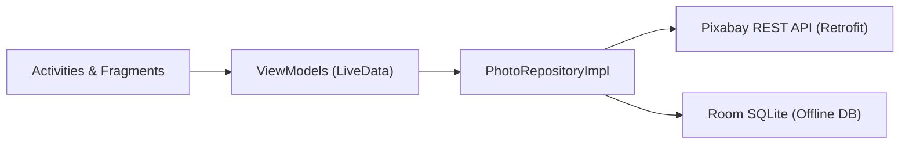

# FlickrImage Browser — Presentation Cheatsheet

## 1. Introduction
- **What it does:** Native Java Android app ([`FlickrApplication`](../app/src/main/java/vn/edu/usth/flickrimagebrowser/FlickrApplication.java)) to browse featured photos, search by keyword with endless scrolling, view HD details, save offline favorites, and organize local collections.
- **Why we need it:** Fast, ad-free Pinterest-style photo discovery with offline Room storage and built-in API rate-limit caching (uses **Pixabay API** since Flickr is now paid-only; see [`PROJECT_EVALUATION.md`](PROJECT_EVALUATION.md)).

## 2. Architecture (MVVM + Repository)
- **UI Layer:** XML Views + `ViewBinding` + Glide + `StaggeredGridLayoutManager` ([`PhotoAdapter`](../app/src/main/java/vn/edu/usth/flickrimagebrowser/ui/common/PhotoAdapter.java)).
- **ViewModel Layer:** Lifecycle-aware `ViewModel`s + `LiveData<Resource<T>>` (`LOADING` | `SUCCESS` | `EMPTY` | `ERROR`).
- **Domain Layer:** Immutable [`Photo`](../app/src/main/java/vn/edu/usth/flickrimagebrowser/domain/model/Photo.java) & [`Collection`](../app/src/main/java/vn/edu/usth/flickrimagebrowser/domain/model/Collection.java) models.
- **Data Layer:** [`PhotoRepositoryImpl`](../app/src/main/java/vn/edu/usth/flickrimagebrowser/data/repository/PhotoRepositoryImpl.java) combining **Retrofit** (remote API + 30m RAM cache) and **Room SQLite** ([`AppDatabase`](../app/src/main/java/vn/edu/usth/flickrimagebrowser/data/local/AppDatabase.java)).

## 3. Activities
1. **[`MainActivity`](../app/src/main/java/vn/edu/usth/flickrimagebrowser/MainActivity.java):** Single-Activity host with `BottomNavigationView` for 3 tabs:
   - [`SearchFragment`](../app/src/main/java/vn/edu/usth/flickrimagebrowser/ui/search/SearchFragment.java): Featured feed, keyword search, pull-to-refresh, infinite pagination.
   - [`FavoritesFragment`](../app/src/main/java/vn/edu/usth/flickrimagebrowser/ui/favorites/FavoritesFragment.java): Offline grid of saved favorite photos.
   - [`CollectionsFragment`](../app/src/main/java/vn/edu/usth/flickrimagebrowser/ui/collections/CollectionsFragment.java) & [`CollectionDetailFragment`](../app/src/main/java/vn/edu/usth/flickrimagebrowser/ui/collections/CollectionDetailFragment.java): Create/manage custom photo boards.
2. **[`PhotoDetailActivity`](../app/src/main/java/vn/edu/usth/flickrimagebrowser/ui/detail/PhotoDetailActivity.java):** Shows 1280px image, creator/tags, Favorite button, "Add to Collection" dialog, and system Share sheet.

## 4. Networking
- **Where:** Pixabay REST API (`https://pixabay.com/api/`) & Pixabay CDN ([`PixabayClient`](../app/src/main/java/vn/edu/usth/flickrimagebrowser/data/remote/PixabayClient.java)).
- **How:** **Retrofit 2 + OkHttp 4 + Gson** for JSON; **Glide 4** for image loading & disk caching; [`PixabayRateLimitInterceptor`](../app/src/main/java/vn/edu/usth/flickrimagebrowser/data/remote/PixabayRateLimitInterceptor.java) for 100 req/60s quota protection.
- **Blocking or Async?** **100% Async** — `Call.enqueue()` for network and [`AppExecutors`](../app/src/main/java/vn/edu/usth/flickrimagebrowser/util/AppExecutors.java) (`diskIO`, `networkIO`) for Room DB. Never blocks the UI thread.
- **API Type:** **REST HTTP `GET` JSON API** ([`PixabayApiService`](../app/src/main/java/vn/edu/usth/flickrimagebrowser/data/remote/PixabayApiService.java)).

## 5. Optimization & UI Overdraw
- **UI Overdraw:** Flat `ConstraintLayout` XMLs ([`activity_main.xml`](../app/src/main/res/layout/activity_main.xml), [`item_photo.xml`](../app/src/main/res/layout/item_photo.xml)) keep overdraw at **1x–2x (Blue/Green)**, with **2x–3x** only on intentional card overlays (bottom text scrim + heart button).
  - *Emulator check:* **Developer Options → Debug GPU overdraw → Show overdraw areas**.
- **Other Optimizations:**
  - **Anti-OOM Image Sizing:** Loads smaller thumbnails (`previewURL`/`webformatURL`) in grids and `1280px` (`largeImageURL`) only in detail view ([`PhotoMapper`](../app/src/main/java/vn/edu/usth/flickrimagebrowser/data/remote/dto/PhotoMapper.java)).
  - **Caching & Diffing:** 30-min RAM page cache + Glide disk cache + `ListAdapter` (`DiffUtil`).

## 6. Demo (Emulator Flow)
1. **Browse & Search:** Scroll Featured masonry grid → Search keyword → Scroll to trigger pagination → Rotate screen (state preserved).
2. **Detail & Actions:** Tap photo → Like (Heart) → Add to Collection → Share.
3. **Offline Tabs:** Check **Favorites** & **Collections** tabs → Show **GPU Overdraw** enabled.

## 7. Conclusion
- **Done:** 100% Java MVVM app, Pixabay search + pagination, 30m cache + rate limiter, Pinterest staggered UI, Room offline Favorites & Collections, unit & DAO tests.
- **Not Done:** User login/OAuth, cloud sync across devices, backend proxy server, image editing.
- **Future Work:** Pinch-to-zoom (`PhotoView`), search filters/history, backend proxy for API keys, cloud backup.
