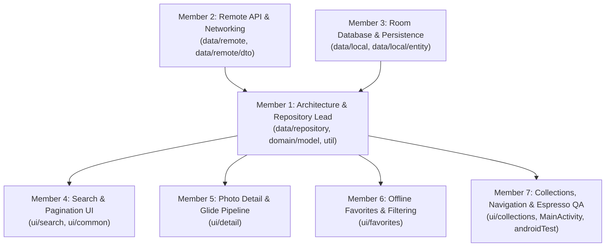

# 7-Member Team Workload, TODOs, Methods & Expected Results

This document defines the complete engineering workload breakdown for a **7-member university project team** building **FlickrImage Browser (Pixabay API Edition)** (`vn.edu.usth.flickrimagebrowser`) over a **4–8-week timeline**.

It is designed so that:
1. **Every member owns a distinct package boundary** to minimize Git merge conflicts.
2. **Every member writes Java production code, XML/data contracts, and automated tests**, satisfying individual university grading criteria.
3. **Each task specifies exact TODOs, Java classes/methods to implement, and verifiable expected results.**

---

## 1. Team Role Matrix & File Ownership Boundaries

| Member | Role Title | Primary Package / File Ownership | Test Ownership |
|---|---|---|---|
| **Member 1** | Architecture, Repository & Concurrency Lead | `data/repository/*`, `domain/model/*`, `util/*`, `ui/AppViewModelFactory.java`, `FlickrApplication.java` | `PhotoRepositoryTest.java` |
| **Member 2** | Remote API, Networking & DTO Mapper Engineer | `data/remote/*`, `data/remote/dto/*`, `local.properties.example` | `PhotoMapperTest.java`, `PixabayApiServiceTest.java` |
| **Member 3** | Room Database, Schema & Migration Engineer | `data/local/*`, `data/local/entity/*`, `app/schemas/*` | `PhotoDaoTest.java`, `CollectionDaoTest.java` |
| **Member 4** | Search Discovery, Pagination & Grid UI Engineer | `ui/search/*`, `ui/common/PhotoAdapter.java`, `res/layout/fragment_search.xml`, `res/layout/item_photo.xml` | `SearchViewModelTest.java` |
| **Member 5** | Photo Detail, Metadata & Collection Assignment Engineer | `ui/detail/*`, `res/layout/activity_photo_detail.xml` | `DetailViewModelTest.java` |
| **Member 6** | Offline Favorites, Local Search & Undo UX Engineer | `ui/favorites/*`, `res/layout/fragment_favorites.xml` | `FavoritesViewModelTest.java` |
| **Member 7** | Collections UI, Navigation Host & Espresso QA Engineer | `ui/collections/*`, `MainActivity.java`, `res/layout/fragment_collections.xml`, `res/layout/item_collection.xml`, `res/layout/activity_main.xml` | `CollectionsViewModelTest.java`, `MainActivityNavigationTest.java` |

---

## 2. Detailed Member-by-Member Breakdown (TODOs, Methods & Expected Results)

---

### Member 1 — Architecture, Repository & Concurrency Lead

#### Scope & Objective
Own the `PhotoRepository` contract and implementation (`PhotoRepositoryImpl`), background thread orchestration (`AppExecutors`), generic UI state modeling (`Resource<T>`), and dependency wiring (`AppContainer`, `AppViewModelFactory`).

#### Concrete TODOs
- [ ] **TODO 1.1:** Maintain and extend [`Resource<T>`](../app/src/main/java/vn/edu/usth/flickrimagebrowser/util/Resource.java) to carry pagination metadata (current page, total results, `hasMorePages`) alongside `Status` (`LOADING`, `SUCCESS`, `EMPTY`, `ERROR`).
- [ ] **TODO 1.2:** Implement multi-page result merging and favorite-flag synchronization in [`PhotoRepositoryImpl`](../app/src/main/java/vn/edu/usth/flickrimagebrowser/data/repository/PhotoRepositoryImpl.java) off the main thread using [`AppExecutors`](../app/src/main/java/vn/edu/usth/flickrimagebrowser/util/AppExecutors.java).
- [ ] **TODO 1.3:** Implement collection-photo association methods in `PhotoRepository` (`addPhotoToCollection`, `removePhotoFromCollection`, `observePhotosInCollection`, `deleteCollection`).
- [ ] **TODO 1.4:** Write comprehensive unit tests in [`PhotoRepositoryTest`](../app/src/test/java/vn/edu/usth/flickrimagebrowser/data/repository/PhotoRepositoryTest.java) covering HTTP 400/401/429 errors, missing API keys, and favorite/collection persistence calls.

#### Methods to Implement / Extend
| Class | Method Signature | Description |
|---|---|---|
| `PhotoRepository` / `PhotoRepositoryImpl` | `LiveData<Resource<List<Photo>>> searchPhotos(String query, int page, int perPage)` | Executes asynchronous Retrofit call to `PixabayApiService`, clamps `perPage` (`3..200`), validates HTTP status (`400`, `401`, `429`), merges favorite IDs from `PhotoDao` on `diskIO`, and posts `Resource`. |
| `PhotoRepository` / `PhotoRepositoryImpl` | `void toggleFavorite(Photo photo)` & `void setFavorite(Photo photo, boolean isFavorite)` | Upserts `PhotoEntity` on `diskIO()` and cleans up unreferenced non-favorite rows via `deleteOrphanIfUnreferenced`. |
| `PhotoRepository` / `PhotoRepositoryImpl` | `void addPhotoToCollection(long collectionId, Photo photo)` & `void removePhotoFromCollection(long collectionId, String photoId)` | Ensures the `PhotoEntity` exists in `photos` and inserts/deletes `CollectionPhotoCrossRef` on `diskIO()`. |
| `AppViewModelFactory` | `<T extends ViewModel> T create(Class<T> modelClass)` | Supplies `PhotoRepository` to all ViewModels without reflection or heavy DI frameworks. |

#### Expected Results
- **Functional:** Zero `NetworkOnMainThreadException` or Room main-thread exceptions across the app; all ViewModels interact exclusively with `PhotoRepository`.
- **Verification:** `./gradlew testDebugUnitTest --tests vn.edu.usth.flickrimagebrowser.data.repository.PhotoRepositoryTest` passes 100% of test cases.

---

### Member 2 — Remote API, Networking & DTO Mapper Engineer

#### Scope & Objective
Own the Pixabay REST API integration (`PixabayApiService`, `PixabayClient`), OkHttp timeout/logging/interceptor configuration, Gson DTO models (`PixabaySearchResponse`, `PixabayHitDto`), and null-safe DTO-to-Domain conversion (`PhotoMapper`).

#### Concrete TODOs
- [x] **TODO 2.1:** Maintain [`PixabayApiService`](../app/src/main/java/vn/edu/usth/flickrimagebrowser/data/remote/PixabayApiService.java) for `GET https://pixabay.com/api/` and optionally extend with `id` or `category`/`order` parameters for advanced filtering.
- [x] **TODO 2.2:** Configure [`PixabayClient`](../app/src/main/java/vn/edu/usth/flickrimagebrowser/data/remote/PixabayClient.java) with timeouts and sanitized logging interceptors (redacting `key=` from logged URLs), plus optional fallback/mock response mode when `PIXABAY_API_KEY` is unconfigured for classroom demos.
- [x] **TODO 2.3:** Harden [`PhotoMapper`](../app/src/main/java/vn/edu/usth/flickrimagebrowser/data/remote/dto/PhotoMapper.java) to map `webformatURL` / `previewURL` to `thumbnailUrl`, `largeImageURL` / `webformatURL` to `detailUrl`, and fallback metadata cleanly when `tags` or `user` are blank.
- [x] **TODO 2.4:** Write unit tests in [`PhotoMapperTest`](../app/src/test/java/vn/edu/usth/flickrimagebrowser/data/remote/dto/PhotoMapperTest.java) verifying Pixabay JSON mapping and fallback behavior.

#### Methods to Implement / Extend
| Class | Method Signature | Description |
|---|---|---|
| `PixabayApiService` | `Call<PixabaySearchResponse> searchPhotos(String apiKey, String query, String imageType, boolean safeSearch, int page, int perPage)` | Queries `GET .` with `key`, `q`, `image_type`, `safesearch`, `page`, `per_page`. |
| `PixabayClient` | `PixabayApiService createService(String baseUrl)` | Builds `OkHttpClient` (15s connect/write, 20s read timeouts, sanitized `HttpLoggingInterceptor`) and `Retrofit` with `GsonConverterFactory`. |
| `PhotoMapper` | `Photo fromDto(PixabayHitDto dto, boolean isFavorite)` | Safely maps a `PixabayHitDto` to a domain `Photo` or returns `null` if `id`/URLs are unresolvable. |
| `PhotoMapper` | `List<Photo> fromDtoList(List<PixabayHitDto> dtos, Set<String> favoriteIds)` | Batch-maps DTOs while filtering malformed items and marking saved favorites. |

#### Expected Results
- **Functional:** Valid JSON responses from Pixabay are parsed without `NullPointerException` or `JsonSyntaxException`, and HTTP/application errors are surfaced cleanly.
- **Verification:** `./gradlew testDebugUnitTest --tests vn.edu.usth.flickrimagebrowser.data.remote.dto.*` passes all mapper and JSON parsing tests.

---

### Member 3 — Room Database, Schema & Migration Engineer

#### Scope & Objective
Own the local SQLite persistence layer using Room (`AppDatabase`, `PhotoDao`, `CollectionDao`, `PhotoEntity`, `CollectionEntity`, `CollectionPhotoCrossRef`, `CollectionWithPhotos`), database indices/foreign keys, and non-destructive schema migrations.

#### Concrete TODOs
- [ ] **TODO 3.1:** Maintain and extend [`PhotoEntity`](../app/src/main/java/vn/edu/usth/flickrimagebrowser/data/local/entity/PhotoEntity.java), [`CollectionEntity`](../app/src/main/java/vn/edu/usth/flickrimagebrowser/data/local/entity/CollectionEntity.java), and [`CollectionPhotoCrossRef`](../app/src/main/java/vn/edu/usth/flickrimagebrowser/data/local/entity/CollectionPhotoCrossRef.java) with composite primary keys, `ForeignKey.CASCADE` constraints, and query indices.
- [ ] **TODO 3.2:** Extend [`PhotoDao`](../app/src/main/java/vn/edu/usth/flickrimagebrowser/data/local/PhotoDao.java) with local search/filter queries (`searchFavoritePhotos(String query)`) and sorting queries.
- [ ] **TODO 3.3:** Extend [`CollectionDao`](../app/src/main/java/vn/edu/usth/flickrimagebrowser/data/local/CollectionDao.java) with `@Transaction` queries to observe a single collection with all its photos (`observeCollectionWithPhotosById(long collectionId)`), rename a collection, and count photos per collection.
- [ ] **TODO 3.4:** Maintain [`AppDatabase.MIGRATION_1_2`](../app/src/main/java/vn/edu/usth/flickrimagebrowser/data/local/AppDatabase.java) and exported schema files under `app/schemas/` without using `fallbackToDestructiveMigration()`.
- [ ] **TODO 3.5:** Expand [`PhotoDaoTest`](../app/src/androidTest/java/vn/edu/usth/flickrimagebrowser/data/local/PhotoDaoTest.java) and add `CollectionDaoTest.java` verifying foreign-key cascades and orphan retention.

#### Member 3 Status — 2026-10-23 (Week 2)

- The user confirmed Week 2: Member 3's data-layer contracts are active. Work is on `feat/database-schema`.
- **Implemented, verification pending (TODO 3.2 / 3.3):** Favorite search by title/owner, saved-date and case-insensitive title ordering, transactional single-collection observation (both documented method names), collection renaming, and observable photo counts. Photo upserts now preserve existing collection memberships instead of triggering `REPLACE` cascades.
- **Test coverage added (TODO 3.5):** Expanded `PhotoDaoTest`, added `CollectionDaoTest` and a LiveData helper for search/sorting, updates, database reopen, uniqueness, foreign-key cascades, membership preservation, and orphan retention. TODO 3.5 remains unchecked until these tests execute successfully.
- **Schema decision (TODO 3.1 / 3.4):** Existing entity keys, foreign keys, and indices were retained. DAO-only changes do not change the database layout; database version 1, exported `app/schemas/.../1.json`, and the existing future `MIGRATION_1_2` placeholder remain unchanged. No destructive migration was introduced.
- **Verification:** Independent source review found no actionable findings; `git diff --check` and 18 static SQLite checks against the exported v1 schema and DAO SQL passed. Gradle 9.6 started with JDK 25 but failed before task execution because no Android SDK was configured (`SDK location not found`). `assembleDebug`, `testDebugUnitTest`, and `assembleDebugAndroidTest` did not execute; `connectedDebugAndroidTest` was skipped because no SDK/emulator/device was available. Static SQL checks do not verify Room-generated code or LiveData behavior. All Member 3 checkboxes remain open pending Android verification; no completed milestone is claimed.

#### Methods to Implement / Extend
| Class | Method Signature | Description |
|---|---|---|
| `PhotoDao` | `LiveData<List<PhotoEntity>> observeFavoritePhotos()` | Emits ordered favorite photos (`WHERE is_favorite = 1 ORDER BY saved_at DESC`). |
| `PhotoDao` | `LiveData<List<PhotoEntity>> searchFavoritePhotos(String query)` | Filters favorite photos offline by `title` or `owner_name LIKE '%' || :query || '%'`. |
| `PhotoDao` | `void deleteOrphanIfUnreferenced(String photoId)` | Deletes a row from `photos` only when `is_favorite = 0` AND no row in `collection_photo_cross_ref` references `photoId`. |
| `CollectionDao` | `LiveData<List<CollectionWithPhotos>> observeCollectionsWithPhotos()` | Transactionally loads all collections with their associated `PhotoEntity` lists. |
| `CollectionDao` | `LiveData<CollectionWithPhotos> observeCollectionById(long collectionId)` | Loads a single collection and its saved photos for the Collection Detail view. |
| `CollectionDao` | `int renameCollection(long collectionId, String newName)` | Updates collection name while respecting the unique index on `collections(name)`. |

#### Expected Results
- **Functional:** Favorites and collections persist across process death and app restarts; deleting a collection cascades only to `collection_photo_cross_ref` without deleting favorited photos; unfavoriting a photo retains it if it belongs to a collection.
- **Verification:** Room compiles with zero schema warnings, exports `app/schemas/.../1.json`, and passes `./gradlew connectedDebugAndroidTest` on an emulator/device.

---

### Member 4 — Search Discovery, Pagination & Grid UI Engineer

#### Scope & Objective
Own the photo discovery experience (`SearchFragment`, `SearchViewModel`, `PhotoAdapter`, `fragment_search.xml`, `item_photo.xml`), including keyword search, pagination (`loadNextPage`), configuration-change retention, and Loading / Empty / Error / Retry UI states.

#### Concrete TODOs
- [x] **TODO 4.1:** Enhance [`SearchViewModel`](../app/src/main/java/vn/edu/usth/flickrimagebrowser/ui/search/SearchViewModel.java) to support multi-page pagination (`currentPage`, `isLoadingNextPage`, accumulating `List<Photo>` across pages).
- [x] **TODO 4.2:** Add a `RecyclerView.OnScrollListener` in [`SearchFragment`](../app/src/main/java/vn/edu/usth/flickrimagebrowser/ui/search/SearchFragment.java) that triggers `viewModel.loadNextPage()` when the user scrolls near the bottom of the 2-column `GridLayoutManager`.
- [x] **TODO 4.3:** Optimize [`PhotoAdapter`](../app/src/main/java/vn/edu/usth/flickrimagebrowser/ui/common/PhotoAdapter.java) using `ListAdapter` + `DiffUtil.ItemCallback` and Glide thumbnail loading (`webformatURL` / `previewURL`, `centerCrop`, placeholder and error drawables) so full-resolution images are never loaded in the grid.
- [x] **TODO 4.4:** Expand [`SearchViewModelTest`](../app/src/test/java/vn/edu/usth/flickrimagebrowser/ui/search/SearchViewModelTest.java) to verify pagination accumulation, rotation deduplication, empty states, and retry recovery.

#### Methods to Implement / Extend
| Class | Method Signature | Description |
|---|---|---|
| `SearchViewModel` | `void submitQuery(String query, boolean forceRefresh)` | Normalizes query, skips duplicate requests on screen rotation when `forceRefresh == false`, and resets page to `1`. |
| `SearchViewModel` | `void loadNextPage()` | Increments page counter and appends the next page of results if not already loading. |
| `SearchViewModel` | `void retryLastQuery()` | Re-triggers the failed query or page load with `forceRefresh = true`. |
| `SearchFragment` | `void renderState(Resource<List<Photo>> resource)` | Toggles visibility of `progressLoading`, `recyclerPhotos`, `layoutState`, and `buttonRetry`. |
| `PhotoAdapter` | `void onBindViewHolder(PhotoViewHolder holder, int position)` | Binds title, owner, favorite heart state, and Glide thumbnail request. |

#### Expected Results
- **Functional:** Users can search keywords, scroll smoothly through paginated 2-column photo grids, rotate the device without re-triggering network calls, and recover from network/API errors using the **Retry** button.
- **Verification:** `./gradlew testDebugUnitTest --tests vn.edu.usth.flickrimagebrowser.ui.search.SearchViewModelTest` passes.

---

### Member 5 — Photo Detail, Metadata & Collection Assignment Engineer

#### Scope & Objective
Own the photo detail experience (`PhotoDetailActivity`, `DetailViewModel`, `activity_photo_detail.xml`), loading large detail images (`largeImageURL`), displaying photo metadata, toggling favorite state in real time, and assigning a photo to a local collection.

#### Concrete TODOs
- [ ] **TODO 5.1:** Enhance [`DetailViewModel`](../app/src/main/java/vn/edu/usth/flickrimagebrowser/ui/detail/DetailViewModel.java) to expose `LiveData<List<Collection>>` and `addPhotoToCollection(long collectionId)` alongside `getIsFavorite()` and `toggleFavorite()`.
- [ ] **TODO 5.2:** Add an **"Add to Collection"** button and selection dialog (`AlertDialog` or `BottomSheetDialogFragment`) in [`PhotoDetailActivity`](../app/src/main/java/vn/edu/usth/flickrimagebrowser/ui/detail/PhotoDetailActivity.java) so users can save the current photo into any local collection.
- [ ] **TODO 5.3:** Configure Glide in `PhotoDetailActivity.renderPhotoDetails(...)` to load `photo.getDetailUrl()` (`largeImageURL`) with `.thumbnail(Glide.with(this).load(photo.getThumbnailUrl()))` so cached grid thumbnails appear instantaneously while the higher-resolution image loads.
- [ ] **TODO 5.4:** Add a Share action on `toolbarDetail` using `Intent.ACTION_SEND` to share the photo title and URL, and write `DetailViewModelTest.java`.

#### Methods to Implement / Extend
| Class | Method Signature | Description |
|---|---|---|
| `PhotoDetailActivity` | `static Intent newIntent(Context context, Photo photo)` | Creates type-safe launch `Intent` carrying the serialized `Photo`. |
| `PhotoDetailActivity` | `void renderPhotoDetails(Photo photo)` | Populates title, owner, description fallback, and Glide detail image (`largeImageURL`). |
| `PhotoDetailActivity` | `void showAddToCollectionDialog(List<Collection> collections)` | Displays a picker dialog allowing the user to add the current photo to a collection. |
| `DetailViewModel` | `void setPhoto(Photo photo)` & `LiveData<Boolean> getIsFavorite()` | Initializes current photo and reactively observes Room favorite state by ID. |
| `DetailViewModel` | `void toggleFavorite()` & `void addToCollection(long collectionId)` | Persists favorite toggle or collection membership via `PhotoRepository`. |

#### Expected Results
- **Functional:** Tapping any photo in Search or Favorites opens `PhotoDetailActivity`, displays the larger image and metadata, updates the heart icon immediately when toggled, and lets the user add the photo to a collection.
- **Verification:** `DetailViewModelTest` passes all unit tests for favorite observation, toggling, and collection assignment.

---

### Member 6 — Offline Favorites, Local Search & Undo UX Engineer

#### Scope & Objective
Own the Favorites screen (`FavoritesFragment`, `FavoritesViewModel`, `fragment_favorites.xml`), offline access to saved photos, local filtering/sorting of favorites, and swipe-to-unfavorite with `Snackbar` undo.

#### Concrete TODOs
- [ ] **TODO 6.1:** Extend [`FavoritesViewModel`](../app/src/main/java/vn/edu/usth/flickrimagebrowser/ui/favorites/FavoritesViewModel.java) with local search filtering (`setFilterQuery(String)`) and sort order switching (`SAVED_DATE_DESC`, `TITLE_ASC`) over the Room favorites list.
- [ ] **TODO 6.2:** Implement `Snackbar` undo in [`FavoritesFragment`](../app/src/main/java/vn/edu/usth/flickrimagebrowser/ui/favorites/FavoritesFragment.java) when a user unfavorites a photo from the Favorites grid (`viewModel.setFavorite(photo, true)` on Undo click).
- [ ] **TODO 6.3:** Verify offline behavior (Airplane Mode): saved favorite metadata loads from Room and previously viewed images render from Glide's disk cache (`DiskCacheStrategy.AUTOMATIC`), falling back gracefully to `ic_broken_image` if never cached.
- [ ] **TODO 6.4:** Write `FavoritesViewModelTest.java` testing live favorites observation, local filtering, remove-and-undo restoration, and empty-state transitions.

#### Methods to Implement / Extend
| Class | Method Signature | Description |
|---|---|---|
| `FavoritesViewModel` | `LiveData<List<Photo>> getFavorites()` | Exposes filtered/sorted list of favorite `Photo` items from `PhotoRepository.observeFavorites()`. |
| `FavoritesViewModel` | `void setFilterQuery(String query)` | Filters saved favorites in-memory or via `PhotoDao.searchFavoritePhotos(query)`. |
| `FavoritesViewModel` | `void removeFavorite(Photo photo)` & `void restoreFavorite(Photo photo)` | Removes a favorite and supports one-tap `Snackbar` undo restoration. |
| `FavoritesFragment` | `void renderFavorites(List<Photo> favorites)` | Updates `PhotoAdapter` and toggles `textEmptyFavorites` vs. `recyclerFavorites`. |

#### Expected Results
- **Functional:** Favorites screen works 100% offline, updates automatically whenever a photo is favorited/unfavorited anywhere in the app, and prevents accidental deletions via `Snackbar` undo.
- **Verification:** `FavoritesViewModelTest` passes all unit tests.

---

### Member 7 — Collections UI, Navigation Host & Espresso QA Engineer

#### Scope & Objective
Own the Collections feature UI (`CollectionsFragment`, `CollectionsViewModel`, `CollectionAdapter`, `fragment_collections.xml`, `item_collection.xml`), the Single-Activity navigation host (`MainActivity`, `activity_main.xml`, `bottom_nav_menu.xml`), and end-to-end Espresso UI tests.

#### Concrete TODOs
- [ ] **TODO 7.1:** Enhance [`CollectionsFragment`](../app/src/main/java/vn/edu/usth/flickrimagebrowser/ui/collections/CollectionsFragment.java) and [`CollectionsViewModel`](../app/src/main/java/vn/edu/usth/flickrimagebrowser/ui/collections/CollectionsViewModel.java) to support creating, renaming, and deleting collections with validation (non-empty unique names).
- [ ] **TODO 7.2:** Implement collection click handling (opening a dialog or detail view displaying the `List<Photo>` inside the selected collection and allowing photo removal from that collection).
- [ ] **TODO 7.3:** Maintain [`MainActivity`](../app/src/main/java/vn/edu/usth/flickrimagebrowser/MainActivity.java) bottom navigation state across configuration changes (`KEY_SELECTED_TAB` in `onSaveInstanceState`).
- [ ] **TODO 7.4:** Write `CollectionsViewModelTest.java` (JVM unit test) and `MainActivityNavigationTest.java` (Espresso instrumentation test verifying bottom navigation switching between Search, Favorites, and Collections tabs).

#### Methods to Implement / Extend
| Class | Method Signature | Description |
|---|---|---|
| `CollectionsViewModel` | `LiveData<List<Collection>> getCollections()` | Observes all user collections with their photo counts. |
| `CollectionsViewModel` | `void createCollection(String name, String description)` | Validates and inserts a new collection via `PhotoRepository`. |
| `CollectionsViewModel` | `void deleteCollection(Collection collection)` | Deletes the collection entity and cascades cleanup of its cross-ref rows. |
| `CollectionAdapter` | `void onBindViewHolder(CollectionViewHolder holder, int position)` | Binds collection name, photo count badge, click listener, and delete action. |
| `MainActivity` | `void switchFragment(Fragment fragment, String tag)` | Performs fragment transactions for `SearchFragment`, `FavoritesFragment`, and `CollectionsFragment`. |

#### Expected Results
- **Functional:** Users can switch seamlessly between Search, Favorites, and Collections tabs, create/delete collections, view photos inside each collection, and retain active tab state on rotation.
- **Verification:** `CollectionsViewModelTest` passes on JVM and `MainActivityNavigationTest` passes via Espresso on an emulator/device.

---

## 3. 8-Week Synchronized Team Schedule & Milestones

| Week | Milestone | Active Members & Integration Checkpoints |
|---|---|---|
| **Week 1** | **M1: Project Bootstrap & Architecture Lock** | **All Members:** Verify Java-only Gradle build (`assembleDebug`), review package boundaries, configure `local.properties` (`PIXABAY_API_KEY`), and run baseline tests (`testDebugUnitTest`). |
| **Week 2** | **M2: Data Layer Contracts (API + Room)** | **M1, M2, M3:** Finalize `PixabayApiService`, `PhotoMapper`, `AppDatabase` entities/DAOs, and `PhotoRepository` interface so UI members can build against stable contracts. |
| **Week 3** | **M3: Core Search & Thumbnail Grid** | **M2, M4:** Wire `SearchFragment` + `SearchViewModel` + `PhotoAdapter` with live Pixabay search, Loading/Empty/Error/Retry states, and unit tests. |
| **Week 4** | **M4: Photo Detail & Favorites Persistence** | **M3, M5, M6:** Wire `PhotoDetailActivity` + `DetailViewModel` and `FavoritesFragment` + `FavoritesViewModel` with real-time Room favorite toggling. |
| **Week 5** | **M5: Pagination & Offline Favorites Polish** | **M1, M4, M6:** Add endless scroll pagination in Search and local filter/sort + `Snackbar` undo in Favorites. |
| **Week 6** | **M6: Collections End-to-End Flow** | **M1, M3, M5, M7:** Connect "Add to Collection" in `PhotoDetailActivity` with `CollectionsFragment` creation, deletion, and collection photo browsing. |
| **Week 7** | **M7: Automated Testing & Bug Bash** | **All Members:** Complete unit tests (`M1, M2, M4, M5, M6, M7`) and instrumented Room/Espresso tests (`M3, M7`); verify zero memory leaks or main-thread stalls. |
| **Week 8** | **M8: Final Verification, Docs & Demo Prep** | **All Members:** Run full Gradle verification suite, freeze documentation (`README.md`, `ARCHITECTURE.md`, `PROJECT_EVALUATION.md`), and prepare final presentation. |

---

## 4. Definition of Done & Grading Checklist per Member

Before opening or merging a Pull Request, each of the 7 team members must verify:
1. **Zero Kotlin Files:** `find app/src -name "*.kt"` outputs nothing; all new classes are pure Java (`.java`) and XML (`.xml`).
2. **No Hardcoded Secrets:** `PIXABAY_API_KEY` is read exclusively via `BuildConfig.PIXABAY_API_KEY` from untracked `local.properties`.
3. **Main-Thread Safety:** All Retrofit calls use asynchronous `.enqueue(...)` and all Room mutations run on `AppExecutors.diskIO()`.
4. **Tests Pass:** `./gradlew assembleDebug testDebugUnitTest assembleDebugAndroidTest` exits with code `0` and the member's assigned test class passes all assertions.
